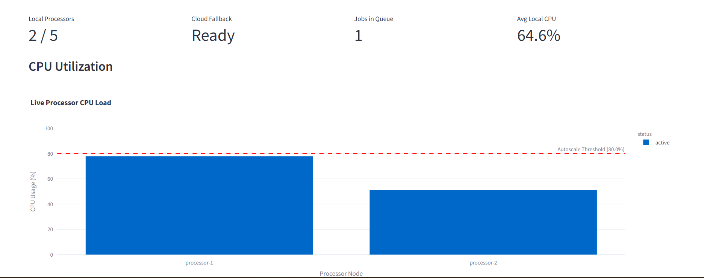

# PixelRouter

> Scalable hybrid-cloud image processing platform

PixelRouter is a distributed image processing system that accepts image uploads, routes jobs across local Docker processors, and falls back to Google Cloud Run when local capacity is exhausted. The processing pipeline uses `rembg` for background removal and Salesforce BLIP for image captioning.

## Architecture



| Service | Port | Technology |
| --- | ---: | --- |
| Upload service | 8000 | FastAPI, Redis, Google Cloud Storage |
| Load balancer | 8001 | FastAPI, Redis, HTTPX, Docker SDK |
| Local processors | 8002+ | FastAPI, rembg, BLIP, psutil |
| Cloud processor | Cloud Run | Google Cloud Run |
| Dashboard | 8501 | Streamlit, Plotly |
| State store | 6379 | Redis |

### Processing flow

1. The upload service validates the image and stores it in Google Cloud Storage.
2. The load balancer selects the least-loaded processor using queue depth and CPU usage.
3. Redis stores the job record and processor queue.
4. A processor removes the image background and generates a caption with BLIP.
5. The processed image and job metadata are written back to Google Cloud Storage and Redis.
6. Local processors scale from the Docker-managed pool up to the configured limit before cloud fallback is used.

## Setup

### Prerequisites

- Docker Desktop with Docker Compose
- A Google Cloud project and storage bucket
- A Google Cloud service-account JSON key

Copy the environment template:

```powershell
Copy-Item .env.example .env
```

Place the service-account key in the project root:

```text
gcp-key.json
```

Update `.env` with the Google Cloud project, bucket, and Cloud Run processor settings. The Docker Compose configuration mounts the key into the containers.

## Run

Build the images:

```powershell
docker compose build
```

Start the platform:

```powershell
docker compose up -d
```

Check service status:

```powershell
docker compose ps
```

Open the dashboard:

```text
http://localhost:8501
```

The API documentation is available at:

```text
http://localhost:8000/docs
http://localhost:8001/docs
```

View logs:

```powershell
docker compose logs -f
```

Stop the platform:

```powershell
docker compose down
```
